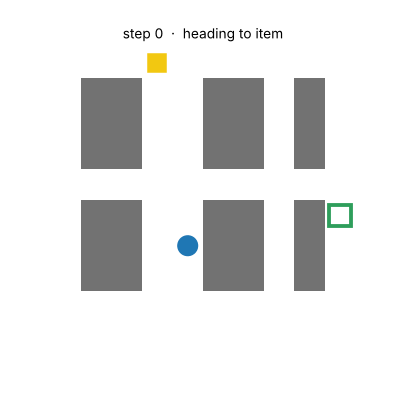

# Teaching a Warehouse Robot to Deliver: Q-tables to Deep Q-Networks, and Where RL Falls Short

> **Scenario.** I play the AI engineer at *Okanogan*, a fictional online retailer. Management wants autonomous carts that (1) deliver an item to a target location and (2) never hit a shelf. My job: find out whether reinforcement learning can meet both requirements, and say honestly where it can't.

Based on the Manning liveProject *Deep Reinforcement Learning for Self-Driving Robots*. All code, experiments and analysis in this repo are my own.



## The story in one minute

| Chapter | Question | What I built | Measured result |
|---|---|---|---|
| 1. Framing | Is this an RL problem? | State/action/reward framing; Taxi as a sandbox | Random driver completes only **~3%** of trips |
| 2. Tabular Q-learning | Can a lookup table do it? | Q-learning on Taxi-v4 | **100%** delivered in 12.8 steps (200 unseen episodes) |
| 3. Naive DQN | What breaks when the state space explodes? | Custom 10x10 warehouse, 656,880 states; PyTorch DQN | Table can't cover it; naive DQN delivers **0.3%** |
| 4. Stabilising DQN | Which fix matters? | 4-way ablation x 3 seeds | Replay: **45.6%**, replay + target: **47.1%**, target only: **1.6%** |
| 5. Verdict | Does it meet the requirements? | Greedy evaluation, failure analysis, safety mask | Delivery **36%** (seeds: 36-57%); bumps in 3.7% of episodes |

## Verdict for management

- **Requirement 1 (deliver): not met.** The best trained policy delivers 36% of trips greedily versus 100% for a shortest-path planner that knows the map. When it delivers, its route is near-optimal (path efficiency 0.985).
- **Requirement 2 (never hit a shelf): not met by learning alone.** Greedy bumps in 3.7% of episodes. Adding random exploration pushes that to 29-67%. A hard-coded **safety mask** (never move into a blocked cell) makes it zero by construction, so safety should come from a mechanism, not from the reward.
- **Why it fails:** all 192 failed greedy episodes were loops, where the robot oscillates between states until time runs out.
- **Recommendation:** for a known, static warehouse a classical planner meets both requirements today. RL becomes interesting where layouts change or other robots interact, and then only with a safety shield.

## Four findings worth remembering

1. **Reward design can teach a robot to fail.** With episode-ending collisions, every DQN variant learned to crash immediately in my first test. Making a bump a penalty that doesn't end the episode fixed it.
2. **Experience replay is what made DQN work here.** Target network alone: 1.6%. Replay alone: 45.6%. Adding a target network on top: 47.1%, not distinguishable from replay alone with 3 seeds.
3. **Training curves lied.** They showed 80-96% delivery because they were measured with 5% random actions and ignored bumps. Evaluate greedily and count safety events separately.
4. **A table's problem is coverage, not memory.** 656,880 states fit in ~21 MB, but the whole 120k-step training budget can't visit each of them once.

## Results

| Ablation (300 unseen episodes, mean ± std over 3 seeds) | Delivered | Episodes with a bump |
|---|---|---|
| naive DQN | 0.3% ± 0.3 | 5.1% ± 7.2 |
| + target network only | 1.6% ± 1.2 | 0.0% |
| + replay only | 45.6% ± 8.6 | 0.1% ± 0.2 |
| + replay + target network | 47.1% ± 10.7 | 1.4% ± 2.0 |


Best-seed policy vs. baselines, and what noise and a safety mask change (chapter 5):

| Policy | Delivered | Episodes with a bump | Path efficiency |
|---|---|---|---|
| random | 5.3% | 100% | 0.27 |
| trained DQN (greedy) | 36.0% | 3.7% | 0.985 |
| shortest-path reference | 100% | 0% | 1.00 |
| DQN + safety mask | 37.3% | 0% | 0.984 |
| DQN + safety mask + 10% safe random actions | 62.3% | 0% | 0.70 |

## Limitations (read these before trusting the numbers)

- 3 seeds per variant; the replay vs. replay + target difference is within noise.
- The headline policy is seed 0, the weakest of the three seeds for that variant (36%, 48%, 57%).
- Single warehouse layout, simulated, and the robot senses its own position and blocked neighbours exactly.
- Chapter 2's hyperparameter sweep uses one seed per setting. Taxi-v4 is used (v3 was retired in current Gymnasium; same dynamics).
- Not tried: Double DQN, history/memory in the state, longer training, other algorithms.

## Repository layout

```
notebooks/     01 framing, 02 Q-learning, 03 naive DQN, 04 ablation, 05 verdict + failure analysis (executed, with outputs)
src/           qlearning.py, dqn.py, warehouse_env.py (custom Gymnasium environment)
experiments/   run_ablation.py (12 runs, ~1 hour on 2 CPU cores)
results/       raw numbers behind every table above
models/        trained network (seed 0, replay + target)
docs/          figures, GIF, presentation outline
```

## Run it

```bash
pip install -r requirements.txt
python experiments/run_ablation.py   # regenerates results/ablation.json
jupyter lab notebooks/
```
