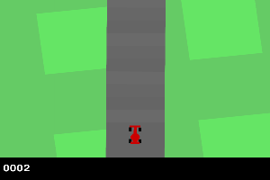
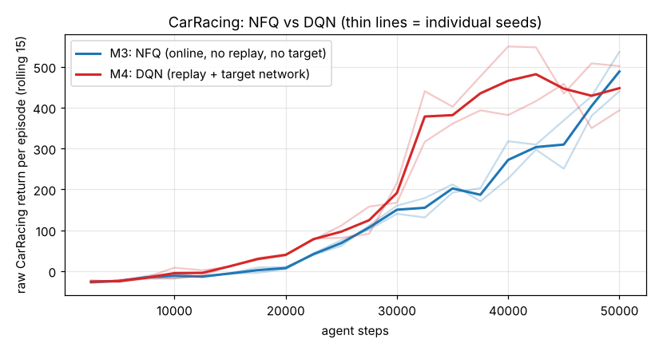
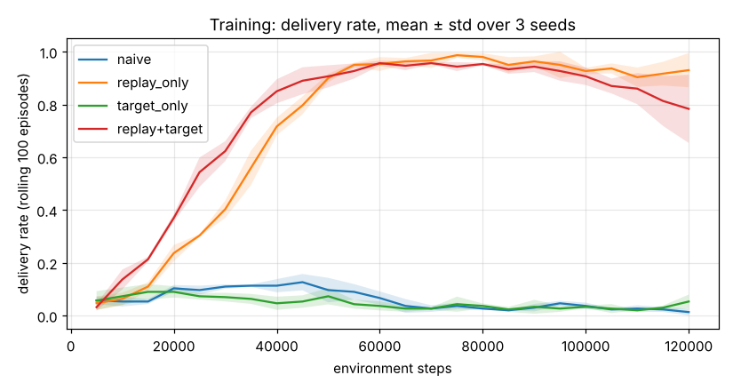

# Teaching a Warehouse Robot to Drive Itself: Deep Reinforcement Learning, Milestone by Milestone

> **Scenario.** I play the AI engineer at *Okanogan*, a fictional online retailer. Management wants autonomous carts that (1) deliver an item to a target location and (2) never hit a shelf. My job: find out whether reinforcement learning can meet both requirements, and say honestly where it can't.

Work through the five milestones of the Manning liveProject *Deep Reinforcement Learning for Self-Driving Robots*: from a random agent, through a Q-table, to a pixel-based deep Q-network, to a custom warehouse environment.

| CarRacing, trained agent (milestone 4) | Warehouse robot, custom environment (milestone 5) |
|---|---|
|  |  |

## The story, milestone by milestone

| # | Notebook | Question | Measured result |
|---|---|---|---|
| 1 | [`m1_environment_basics`](notebooks/m1_environment_basics.ipynb) | What does an agent that acts at random achieve? | Taxi: mean return **-764** over 10 episodes; CartPole: **~26** steps balanced |
| 2 | [`m2_q_learning_taxi`](notebooks/m2_q_learning_taxi.ipynb) | Can a lookup table solve delivery? | **100%** of 200 unseen episodes delivered in **12.8** steps (random: 2%) |
| 3 | [`m3_nfq_carracing`](notebooks/m3_nfq_carracing.ipynb) | Can a network learn to drive from pixels? | Training return **~490** vs **-29** random; greedy score **-19.9** (seed 0) and **508** (seed 1) |
| 4 | [`m4_dqn_carracing`](notebooks/m4_dqn_carracing.ipynb) | Do replay + a target network help? | Learns faster (**378 vs 155** at 32.5k steps); greedy **347 / 406** vs **-20 / 508** |
| 5 | [`m5a`](notebooks/m5a_warehouse_env_naive_dqn.ipynb), [`m5b`](notebooks/m5b_dqn_ablation.ipynb), [`m5c`](notebooks/m5c_verdict_and_safety.ipynb) | Does RL meet Okanogan's two requirements in *our* warehouse? | Delivery **36%** (seeds: 36-57%); bumps in 3.7% of episodes; all failures are loops |

## Verdict for management

- **Requirement 1 (deliver): not met.** The best warehouse policy delivers 36% of trips greedily versus 100% for a shortest-path planner that knows the map. When it delivers, its route is near-optimal (path efficiency 0.985).
- **Requirement 2 (never hit a shelf): not met by learning alone.** Greedy bumps in 3.7% of episodes; random exploration pushes that to 29-67%. A hard-coded **safety mask** (never move into a blocked cell) makes it zero by construction, so safety should come from a mechanism, not from the reward.
- **Recommendation:** for a known, static warehouse a classical planner meets both requirements today. RL becomes interesting where layouts change or robots interact, and then only with a safety shield.

## Findings worth remembering

1. **Training curves lie; greedy evaluation doesn't.** In CarRacing, one NFQ seed trained to ~490 return yet scored -19.9 greedily: its policy steered left forever and never pressed the gas. In the warehouse, training showed 80-96% delivery while greedy delivered 36%. Training curves include 5% random actions and ignore safety events.
2. **Replay + target network gave faster, steadier learning, not a higher final score** (CarRacing, 2 seeds, 50k steps). In the warehouse ablation, replay alone did the work: replay 45.6%, replay + target 47.1%, target alone 1.6%, naive 0.3%.
3. **Reward design can teach a robot to fail.** With episode-ending collisions, every warehouse DQN variant learned to crash immediately in my first test. Making a bump a penalty that doesn't end the episode fixed it.
4. **A table's problem is coverage, not memory.** The warehouse has 656,880 states (about 21 MB as a Q-table), but a 120k-step budget cannot visit each one once.

## Results

**Milestone 4: CarRacing, greedy evaluation on 10 unseen tracks (raw return, max about 900)**

| Method | Seed 0 | Seed 1 | Mean |
|---|---|---|---|
| NFQ (M3: online, no replay, no target) | -19.9 | 508.0 | 244.0 |
| DQN (M4: replay + target network) | 347.5 | 405.6 | 376.6 |
| random policy | -28.7 | | |



**Milestone 5: warehouse ablation (300 unseen episodes, mean ± std over 3 seeds)**

| Variant | Delivered | Episodes with a bump |
|---|---|---|
| naive DQN | 0.3% ± 0.3 | 5.1% ± 7.2 |
| + target network only | 1.6% ± 1.2 | 0.0% |
| + replay only | 45.6% ± 8.6 | 0.1% ± 0.2 |
| + replay + target network | 47.1% ± 10.7 | 1.4% ± 2.0 |

| Warehouse policy (best seed) | Delivered | Episodes with a bump | Path efficiency |
|---|---|---|---|
| random | 5.3% | 100% | 0.27 |
| trained DQN (greedy) | 36.0% | 3.7% | 0.985 |
| shortest-path reference | 100% | 0% | 1.00 |
| DQN + safety mask | 37.3% | 0% | 0.984 |
| DQN + safety mask + 10% safe random actions | 62.3% | 0% | 0.70 |



## Limitations (read these before trusting the numbers)

- CarRacing: 2 seeds per method and 50k agent steps; the NFQ vs DQN mean gap is driven by one collapsed NFQ seed and is not significant.
- Warehouse: 3 seeds per variant; replay vs replay + target is within noise. The headline policy is seed 0, the weakest of its three seeds (36%, 48%, 57%). Single simulated layout; the robot senses its blocked neighbours exactly.
- Environment versions differ from the course: `Taxi-v4` (v3 retired) and `CarRacing-v3` (not v0), using Gymnasium. CarRacing uses a small CNN (the brief mentions an MLP), 42x48 grayscale frames, 4-frame stack, action repeat 4, reward scaled by 0.1, episodes capped at 250 agent steps.
- Chapter 2's hyperparameter sweep uses one seed per setting.
- Not tried: Double DQN, history in the warehouse state, longer CarRacing training, other algorithms.

## How this was made

Built with substantial assistance from Claude (Anthropic): Claude wrote the code, ran every experiment in a CPU sandbox, and drafted the analysis. All numbers in this README come from the executed notebooks and the files in `results/`. The five Manning milestone briefs were used as the specification; their solution text is not reproduced here.

## Repository layout

```
notebooks/     m1..m4 (course milestones), m5a-m5c (custom warehouse environment); executed, with outputs
src/           qlearning.py, dqn.py, warehouse_env.py, carracing.py
experiments/   run_ablation.py (warehouse, 12 runs), run_carracing.py (CarRacing, 4 runs of ~30 min)
results/       raw numbers behind every table above
models/        trained networks
docs/          figures, GIFs, presentation outline
```

## Run it

```bash
pip install -r requirements.txt   # CarRacing also needs: pip install "gymnasium[box2d]"
python experiments/run_ablation.py    # warehouse ablation
python experiments/run_carracing.py   # CarRacing, ~1 hour on 2 CPU cores
jupyter lab notebooks/
```
